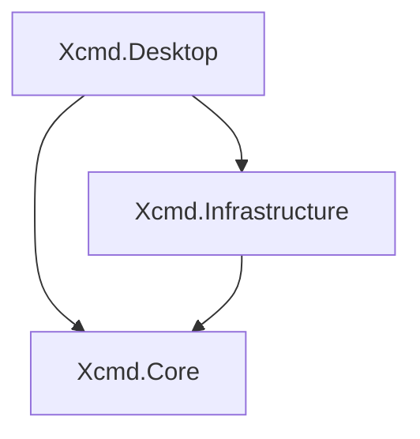

# Code architecture

Keep three production projects: `Xcmd.Core`, `Xcmd.Infrastructure`, and `Xcmd.Desktop`. Improve responsibilities within these projects as workflows grow.

The [technology decision](technology-decision.md) defines the stack. The [development requirements](development-requirements.md) define behavioral evidence and delivery. The [automated-checks policy](automated-checks.md) defines enforced dependencies, API bans, and metric limits.

## Dependencies

Arrows mean a compile-time project dependency:

| Project | Allowed production references | Responsibility |
| --- | --- | --- |
| Core | None | Application values, state, rules, UI-independent workflows, and contracts used by those workflows |
| Infrastructure | Core | Filesystem, persistence, Windows integration, and process launch |
| Desktop | Core, Infrastructure | Controls, presentation state, input routing, interaction coordination, and startup wiring |

Core defines an interface when its behavior needs an external operation. Infrastructure implements the interface. Desktop supplies the implementation and connects application behavior to controls. Desktop may also use Infrastructure directly for interactions that have no Core workflow.

Production projects cannot depend on tests. Infrastructure cannot depend on Desktop or UI libraries. Core cannot depend on either outer project, UI libraries, or platform integrations.

## Core

Put a rule or state transition in Core when its meaning can be stated without controls, input events, rendering, or operating-system calls.

Current examples:

- `PanelRules`: name validation, parent-entry rules, and file ordering.
- `PanelSession` and `DirectoryHistory`: directory state, reads through `IFileSystem`, cancellation of obsolete reads, sorting, and remembered directory cursors.
- `FavoriteDirectories`, `DirectoryUsageBook`, `DirectoryAttention`, and `NameJump`: navigation rules expressed using values and explicit inputs.
- `DirectorySizeCalculator`: traversal, link exclusion, cancellation, and partial measurement results through `IFileSystem`.
- `IFileSystem`, `IExternalLauncher`, and launch plans: application contracts and requests.
- `WorkspaceState` and related records: framework-independent data shared with persistence and the desktop.

Core includes application behavior and data; it is not restricted to domain entities. Shared session records may contain plain window coordinates, column widths, scroll offsets, and command-line state. Desktop interprets their visual meaning, and Infrastructure stores them. Keep Avalonia types out of these records.

Core workflows may be asynchronous and use injected adapters. They do not access files, start processes, read the environment, obtain the current time, or import native functions directly. Pass time and other external inputs explicitly. Keep pure path transformations available.

Keep formatting choices that depend on display culture or presentation context in Desktop. `FileRow` owns file type labels, displayed sizes and dates, measurement tooltips and property-change notifications. `FileEntry` keeps file values and the extension used for sorting.

## Infrastructure

Put code in Infrastructure when it performs an external operation or translates external data and failures into application values.

Current examples:

- `LocalFileSystem` and `DirectoryMonitor`: filesystem operations, enumeration, and change notifications.
- `SessionStore`, `FileTypeSettings`, `FeedbackResolutions`, and `RefinementList`: file formats, storage, and atomic file replacement.
- `WindowsExternalLauncher`, `KeyboardLayouts`, and `SystemIcons`: Windows integration.
- `WindowsLaunchEnvironment`: read the current Windows user/system environment with [CreateEnvironmentBlock](https://learn.microsoft.com/en-us/windows/win32/api/userenv/nf-userenv-createenvironmentblock) and apply a serialized temporary override around ShellExecute. Restore the Xcmd environment after launch; keep process-only variables and track removed persistent names from launcher construction.
- `ReleaseCatalog`, `RestartProcess`, and `StartupDiagnostics`: release files, process handoff, and startup diagnostics.
- `ReleaseFiles`, `BootstrapProgram`, `WindowsShortcut`, and `WindowsTaskbar`: verified release discovery, the permanent entry point, and Windows taskbar properties. The launcher build compiles a small Infrastructure source subset into `Xcmd.exe` with no Core or UI dependency. Its outputs and package lock are separate from the normal library build. The normal three-project dependency graph stays the same.

These adapters may know Xcmd contracts and state records. An adapter does not need to work unchanged in an unrelated application. Make a module general only when a concrete use benefits from it.

Keep user decisions in Core or the interaction that owns them. Infrastructure executes an explicit request, enforces its contract, and handles platform constraints. For example, the copy adapter performs a copy without overwriting; a future conflict workflow decides what to do when the destination exists.

Infrastructure does not select an active panel, open a dialog, restore focus, or update controls. It returns data, tasks, failures, and notifications. Desktop dispatches notifications to the UI thread when needed.

The standalone launcher reports a fatal startup failure with a native Windows error box because no Desktop window exists yet. This startup boundary does not create or control application dialogs. Shortcut creation used by the release script reports failures without opening a window.

Keep an integration interface with its consumer. `IFileSystem` belongs in Core because Core workflows use it. Tests can replace this interface. Do not move every interface into Core or add an interface for every concrete class.

## Desktop

Put code in Desktop when it interprets input, controls an interaction, or maps application values to the actual UI.

Current examples:

- `CommanderWindow`, `PanelView`, dialogs, `FileRow`, and feedback controls: views and presentation state.
- Keyboard routing, focus, rename-editor lifetime, caret position, selection, layout, and render timing.
- `DirectoryUpdates`: deciding when a filesystem result can be applied without interrupting an editor, dialog, menu, or name search.
- `WorkspaceLifecycle`: connecting workspace snapshots, window lifetime, idle update readiness, storage, and process replacement.
- `CommandLineView`: command input, history presentation, name/path insertion, and saved editor state. Core owns command parsing and history rules; Infrastructure performs Windows ShellExecute.
- `App` and constructors: startup and adapter wiring, including existing injection points for tests.

Desktop owns interaction coordination. A command may capture input, call a Core rule or an Infrastructure adapter, await the result, update the view, and restore focus. This is a normal responsibility of this project.

Desktop does not call raw filesystem, process, or native import APIs. It uses Infrastructure for those operations. Calling an adapter from a view is allowed; each call still needs a clear owner, stable inputs, and visible failures. Prefer construction near startup or the owning controller. There is no mandatory composition namespace or container.

Extract a Core workflow when an interaction gains substantial UI-independent decisions: operation planning, conflict choices, queue state, cancellation outcomes, or reusable actions. Keep the control-specific part in Desktop. A helper class or controller inside Desktop is sufficient when the complexity is about controls and their lifetime.

## State and background work

Assign one live owner to each piece of state:

| State | Current owner |
| --- | --- |
| Current directory, latest directory entries, sort order, history, and remembered directory cursors | `PanelSession` in Core |
| Live panel cursor, selected rows, rename draft, applied rows, measured sizes, and scroll position | `PanelView` in Desktop |
| Active panel, dialog lifetime, and coordination between panels | `CommanderWindow` in Desktop |
| Navigation rules and saved favorite/usage values | Core objects held by Desktop |
| Native process, pipe, watcher, and transport resources | Infrastructure adapters |
| Saved workspace | A snapshot captured by Desktop, represented by Core records, and written by Infrastructure |

A saved cursor is a snapshot, not a second live cursor. `PanelView` updates remembered cursors at navigation and capture boundaries. Its rows project the latest result applied to the UI. They may intentionally lag behind `PanelSession.Entries` while editing delays a refresh. Keep those synchronization points explicit.

Capture operation targets when a command starts. A later active-panel change must not change the source, destination, or selected files of that operation. Workers return results to the owner; obsolete results cannot replace newer state.

Give background work an owner, a lifetime, observable progress or completion, and cancellation where needed. Define whether a repeated command replaces, queues, or rejects existing work. Account for partial file changes after cancellation.

Keep blocking waits out of UI paths. Use `async void` only at an event boundary that observes the task and reports failures. Distinguish expected failures, cancellation, partial results, and unexpected faults. Linters do not prove these runtime properties; behavioral tests remain required.

## Assessment and local improvements

The existing dependency direction supports the current product. Core behavior can use controlled adapters, Infrastructure can be tested against real fixtures, and Desktop runs through the same actual controls in interactive and headless modes. These properties already provide useful separation.

The areas that need care are within the projects:

| Area | Current limit | Appropriate next step |
| --- | --- | --- |
| Window and panel coordination | `CommanderWindow` and `PanelView` combine many interactions and state transitions. Partial files divide source text but keep one class and one set of state. | Extract a focused controller or Core workflow when a specific interaction becomes difficult to follow or test. |
| File operations | Copy coordination and rename execution live in Desktop; `PanelSession.FileSystem` exposes the adapter contract. | Keep the simple current path. Add explicit Core operation requests and outcomes when implementing conflicts, queues, or richer cancellation. |
| State synchronization | Applied rows, live cursor/selection, Core directory state, and saved snapshots meet at refresh and restore boundaries. | Preserve a clear owner and add regression scenarios when changing these boundaries. |
| Startup work | `PanelView` loads bundled file-type settings synchronously during construction. API bans do not prove that an adapter call is nonblocking. | If startup work grows or delays are measured, load settings once during initialization and pass the result to panels. |

These are improvement points, not a requirement to refactor all listed code now. New project boundaries would not resolve them by themselves.

## Why keep three projects

The three projects already let the compiler and architecture tests separate application behavior, external operations, and UI dependencies. A separate Desktop.Infrastructure project has no demonstrated independent consumer or dependency policy that needs its own assembly today.

Requiring Infrastructure to know nothing about Xcmd would add generic contracts and conversions around application-specific state, settings, and release handling. Current adapters can remain small by using Core contracts directly.

Keeping Desktop coordination also preserves useful knowledge about editor lifetime, focus, dialogs, and safe refresh timing. Moving those conditions into Core would introduce UI-shaped inputs and callbacks. Extract the independent decisions when they exist.

Organize growing features into folders and focused classes within the current projects. Add feature-cycle checks when feature namespaces exist. Consider a new production project only when a concrete dependency boundary or independent consumer needs compiler enforcement. A large file or a desire for symmetry is not sufficient evidence.

## Tests and usability review

Keep fast rule/action checks, real adapter integration checks in isolated fixtures, and headless checks of the actual Avalonia controls and input routing. Scenario cases describe user actions and outcomes; drivers, native setup, process control, and timing belong in test infrastructure.

For a changed user workflow, request an independent usability reviewer. Give the reviewer the use case, the change, and these criteria without the implementing agent's conclusions:

- Frequent commands use few actions, provide clear result feedback, and avoid unnecessary delays. Measure latency when a stable scenario can establish it.
- Rare actions explain what they do and what they change.
- Rare scenarios can be found and understood inside the application.

Fix each reported problem or record a decision with a reason. A usability review does not approve new product features; record feature questions in the [use cases](use-cases.md).
