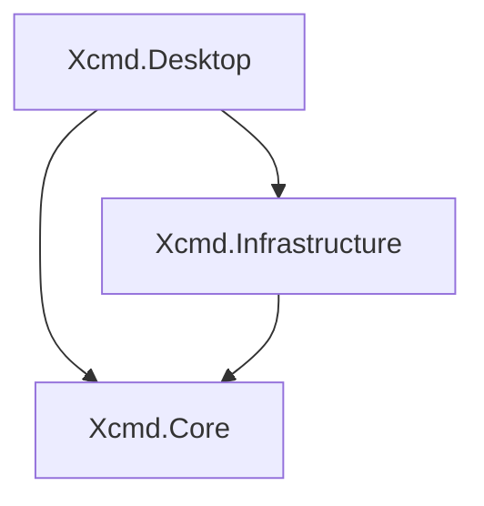

# Code architecture

Keep three production projects: `Xcmd.Core`, `Xcmd.Infrastructure`, and `Xcmd.Desktop`. Improve responsibilities within these projects as workflows grow.

The [technology decision](technology-decision.md) defines the stack. The [development requirements](development-requirements.md) define behavioral evidence and delivery. The [automated-checks policy](automated-checks.md) defines enforced dependencies, API bans, and metric limits.

## Dependencies

Arrows mean a compile-time project dependency:

| Project | Allowed production references | Responsibility |
| --- | --- | --- |
| Core | None | Application values, state, rules, UI-independent workflows, and contracts used by those workflows |
| Infrastructure | Core | Filesystem, persistence, Windows integration, and process launch |
| Desktop | Core, Infrastructure | Controls, presentation state, input routing, interaction coordination, and startup wiring |

Core defines an interface when its behavior needs an external operation. Infrastructure implements the interface. Desktop supplies the implementation and connects application behavior to controls. Desktop may also use Infrastructure directly for interactions that have no Core workflow.

Production projects cannot depend on tests. Infrastructure cannot depend on Desktop or UI libraries. Core cannot depend on either outer project, UI libraries, or platform integrations.

## Core

Put a rule or state transition in Core when its meaning can be stated without controls, input events, rendering, or operating-system calls.

Current examples:

- `PanelRules`: name validation, parent-entry rules, and file ordering.
- `PanelSession` and `DirectoryHistory`: directory state, reads through `IFileSystem`, cancellation of obsolete reads, sorting, and remembered directory cursors.
- `FavoriteDirectories`, `DirectoryUsageBook`, `DirectoryAttention`, and `NameJump`: navigation rules expressed using values and explicit inputs.
- `DirectorySizeCalculator`: traversal, link exclusion, cancellation, and partial measurement results through `IFileSystem`.
- `FileTransferPlanner`, `ClipboardTransferPlanner`, `FileOperationRunner`, and
  `FileOperationQueue`: operation requests, conflict decisions, progress,
  cancellation, and partial results through `IFileOperationStore`.
- `IFileSystem`, `IExternalLauncher`, and launch plans: application contracts and requests.
- `WorkspaceState` and related records: framework-independent data shared with persistence and the desktop.

Core includes application behavior and data; it is not restricted to domain entities. Shared session records may contain plain window coordinates, column widths, scroll offsets, and command-line state. Desktop interprets their visual meaning, and Infrastructure stores them. Keep Avalonia types out of these records.

Core workflows may be asynchronous and use injected adapters. They do not access files, start processes, read the environment, obtain the current time, or import native functions directly. Pass time and other external inputs explicitly. Keep pure path transformations available.

Keep formatting choices that depend on display culture or presentation context in Desktop. `FileRow` owns file type labels, displayed sizes and dates, measurement tooltips and property-change notifications. `FileEntry` keeps file values and the extension used for sorting.

## Infrastructure

`GitFileSystem` wraps the panel filesystem and handles Git log, snapshot and
working-change locations through `IFileSystem`. Core owns the virtual path and
scope rules. The adapter reads Git objects, caches immutable commit changes and
filters working changes by the history scope. `PanelView` uses its existing table,
rows, selection and Git cells for these entries and retains the physical return
state. `GitHistoryController` connects navigation, reports and temporary viewer
files. Git locations are read-only and do not check out commits.

`GitCommitMessageView` owns the inline log message, its text selection and the
current asynchronous read. Cursor changes cancel obsolete reads. `GitFileSystem`
caches full messages by commit within each history context. `GitPanelRows` projects
Git states into normal file rows without making the panel own Git status caches.

Live log and working-change locations refresh their captured status together with
their rows. A new HEAD updates the log, while the commit catalog retains metadata
for open immutable snapshots. Changed-file locations expose deleted paths without
adding them to the snapshot tree. `GitActionRunner` owns cancellation and repeated
command replacement. `ViewerDocument` carries origin and read-only state across
temporary materialization into the existing viewer.

Put code in Infrastructure when it performs an external operation or translates external data and failures into application values.

Archive locations use `ArchivePath` values with a physical source and entry path. `ArchiveFileSystem` routes those values to `ArchiveContents` and delegates ordinary paths to the existing filesystem and operation store. Archive contents stay read-only; extraction uses the existing copy queue. `ArchiveViewerFiles` supplies reports or temporary member files to the existing viewer. SharpCompress types, compression streams, catalog caching and temporary-file ownership stay in Infrastructure. Desktop owns archive key routing and panel focus. Filesystem monitoring skips virtual archive locations; explicit reload and workspace restore use the same archive adapter.

Current examples:

- `LocalFileSystem` and `DirectoryMonitor`: directory enumeration, rename, folder
  creation, and change notifications. `LocalFileOperations` implements the
  `IFileOperationStore` used by the operation queue.
- `FileLockDiagnostics` adds process details to sharing errors at filesystem
  operation boundaries. `WindowsFileUsers` runs a bounded background lookup for
  the item and its descendants. It uses the native
  [file process information class](https://learn.microsoft.com/en-us/windows-hardware/drivers/ddi/wdm/ne-wdm-_file_information_class),
  which Windows reserves for system use; unsupported lookups keep the original
  error and report that the process could not be identified. Console window lookup
  runs in a short-lived helper so console attachment cannot alter the file
  manager's standard handles. The console's root owner identifies the terminal
  window. Application links exist only for a discovered window. Process
  exit monitoring and explicit termination use native process handles, without
  automating another application's UI. Handles are checked against the original
  creation time; termination rejects Xcmd itself and critical Windows processes.
  Ending processes requires an explicit Kill action on the matching row
  and affects only the listed identities, not a process tree. The error
  dialog cancels monitoring on close and retries once when all listed processes
  exit. A registered wait receives the process exit signal on an owned duplicate
  handle and cancels without blocking the UI. Feedback interaction delays
  automatic dismissal.
- `SessionStore` and `FileTypeSettings`: session/settings formats and atomic replacement.
- `IssueStore`, `IssueDatabase`, and `IssueCli`: the independent repository SQLite
  tracker, parameterized SQL, transactional claims and command-line access. The
  native SQLite adapter uses Windows' documented `winsqlite3.dll` interface.
- `WindowsExternalLauncher`, `KeyboardLayouts`, and `SystemIcons`: Windows integration.
- `WindowsLaunchEnvironment`: read the current Windows user/system environment with [CreateEnvironmentBlock](https://learn.microsoft.com/en-us/windows/win32/api/userenv/nf-userenv-createenvironmentblock) and apply a serialized temporary override around ShellExecute. Restore the Xcmd environment after launch; keep process-only variables and track removed persistent names from launcher construction.
- `ReleaseCatalog`, `RestartProcess`, and `StartupDiagnostics`: release files, process handoff, and startup diagnostics.
- `ReleaseFiles`, `BootstrapProgram`, `WindowsShortcut`, and `WindowsTaskbar`: verified release discovery, the permanent entry point, and Windows taskbar properties. The launcher build compiles a small Infrastructure source subset into a self-contained NativeAOT `Xcmd.exe` with no Core or UI dependency. Shortcut creation uses fixed COM interfaces without runtime COM wrappers so the same code works in NativeAOT. Its outputs and package lock are separate from the normal library build. The normal three-project dependency graph stays the same.

These adapters may know Xcmd contracts and state records. An adapter does not need to work unchanged in an unrelated application. Make a module general only when a concrete use benefits from it.

Keep user decisions in Core or the interaction that owns them. Infrastructure executes an explicit request, enforces its contract, and handles platform constraints. `FileOperationRunner` asks Desktop for conflict and error decisions, then passes explicit copy, replace, move, or removal requests to the store.

Infrastructure does not select an active panel, open a dialog, restore focus, or update controls. It returns data, tasks, failures, and notifications. Desktop dispatches notifications to the UI thread when needed.

The standalone launcher reports a fatal startup failure with a native Windows error box because no Desktop window exists yet. This startup boundary does not create or control application dialogs. Shortcut creation used by the release script reports failures without opening a window.

Keep an integration interface with its consumer. `IFileSystem` belongs in Core because Core workflows use it. Tests can replace this interface. Do not move every interface into Core or add an interface for every concrete class.

## Desktop

Button access keys use underlined letters (`AccessText` with `ShowAccessKey = true`), never an Alt shortcut suffix in the caption. Indicate the action performed by Enter with the shared primary button style, without an Enter suffix. When Enter depends on focus, update the primary appearance with that context; do not change keyboard routing merely to style a button. Function-key hints such as F3 may remain visible.

Put code in Desktop when it interprets input, controls an interaction, or maps application values to the actual UI.

Current examples:

- `CommanderWindow`, `PanelView`, dialogs, `FileRow`, and feedback controls: views and presentation state.
- `WindowHeader` and `CommanderFrame`: shared window decoration behavior and the main title/status layout. Reader palettes belong to Desktop; the saved workspace carries only the selected theme ID.
- Keyboard routing, focus, rename-editor lifetime, caret position, selection, layout, and render timing.
- `GitStatusProjection` and `GitRowStatus`: map the current repository and direct
  child repository snapshots to file cells and folder status cells, with
  independent staged and working-tree states. Infrastructure discovers child
  repositories and bounds concurrent Git processes. The header applies before
  child reads finish. Ignored paths and collapsed untracked directories are
  handled without per-file Git processes. `FileNameCell` owns the shared name,
  native Windows icon and rename-editor template and preserves its stable
  feedback IDs. Git does not replace or recolour directory icons.
- `GitStatusView` retains up to eight repository snapshots across navigation.
  Infrastructure checks the nearest `.git` directory or file without starting Git.
  The panel applies the matching snapshot before displaying new rows, then reads
  fresh status in the background. Nested repositories use their own snapshot;
  cancelled root checks and status reads cannot replace the current location.
- `DirectoryUpdates`: deciding when a filesystem result can be applied without interrupting an editor, dialog, menu, or name search.
- `WorkspaceLifecycle`: connecting workspace snapshots, window lifetime, idle update readiness, storage, and process replacement.
- `CommandLineView`: command input, history presentation, name/path insertion, and saved editor state. Core owns command parsing and history rules; Infrastructure performs Windows ShellExecute.
- `App` and constructors: startup and adapter wiring, including existing injection points for tests.

Desktop owns interaction coordination. A command may capture input, call a Core rule or an Infrastructure adapter, await the result, update the view, and restore focus. This is a normal responsibility of this project.

Desktop does not call raw filesystem, process, or native import APIs. It uses Infrastructure for those operations. Calling an adapter from a view is allowed; each call still needs a clear owner, stable inputs, and visible failures. Prefer construction near startup or the owning controller. There is no mandatory composition namespace or container.

Extract a Core workflow when an interaction gains substantial UI-independent decisions: operation planning, conflict choices, queue state, cancellation outcomes, or reusable actions. Keep the control-specific part in Desktop. A helper class or controller inside Desktop is sufficient when the complexity is about controls and their lifetime.

## Syntax highlighting

The reader's [syntax highlighting](syntax-highlighting.md) uses Core text ranges,
an Infrastructure TextMate adapter, and a Desktop palette/text presenter. Keep
the ranges independent of Avalonia so clipboard and image exporters can use the
same selected document. The viewer owns load cancellation and current tokens;
the engine owns no controls or live viewer state.

## Feedback selection

Keep every visible label, status, error and disabled action selectable in feedback. Keep the shared transparent background for `TextBlock`; text without a hit-test surface cannot be selected reliably. Use visual hit testing for feedback so disabled actions remain selectable. Resolve the nearest meaningful element before an outer window's identifier. Exclude only decorative feedback overlays from selection. Attach every application dialog through `FeedbackController` and check new content with real pointer input.

`FeedbackSurface` owns click selection and the transient interaction path shown
in the comment form. A released click opens a comment immediately. Ctrl+click
forwards one ordinary click to the selected control and keeps selection active.
Clear the interaction path on cancellation or window close. Application popups
use the overlay layer so menu contents share the window's feedback hit-test surface.

`FeedbackTarget` supplies stable literal IDs at source creation sites. The
build-time `tools/UiChecks` Roslyn analyzer requires them on application controls
and rejects duplicate declarations. It is tooling, not a fourth production layer,
and is referenced as an analyzer without a runtime dependency. Reused templates
share a source identity; target names distinguish clicked instances.

`FeedbackIssue` is the compact tracker value. `FeedbackController.Notes` is a UI
projection of `IssueStore`, not a second persistence owner. Add/remove operations
change individual rows and refresh the projection; workspace saves cannot replace
tracker state. `FeedbackNote` remains only as a legacy session import DTO.
New snapshots omit `WorkspaceState.Notes`. See [the issue workflow](../../issues/README.md).

## State and background work

Assign one live owner to each piece of state:

| State | Current owner |
| --- | --- |
| Current directory, latest directory entries, sort order, history, and remembered directory cursors | `PanelSession` in Core |
| Live panel cursor, selected rows, rename draft, applied rows, measured sizes, and scroll position | `PanelView` in Desktop |
| Active panel, dialog lifetime, and coordination between panels | `CommanderWindow` in Desktop |
| Independent viewer windows and their lifetime | `FileViewingController` in Desktop |
| Viewer mode, encoding, search, loaded range and visible-file position | Each `FileViewerWindow` in Desktop |
| Navigation rules and saved favorite/usage values | Core objects held by Desktop |
| Native process, pipe, watcher, and transport resources | Infrastructure adapters |
| Saved workspace | A snapshot captured by Desktop, represented by Core records, and written by Infrastructure |

A saved cursor is a snapshot, not a second live cursor. `PanelView` updates remembered cursors at navigation and capture boundaries. Its rows project the latest result applied to the UI. They may intentionally lag behind `PanelSession.Entries` while editing delays a refresh. Keep those synchronization points explicit.

Capture operation targets when a command starts. A later active-panel change must not change the source, destination, or selected files of that operation. Workers return results to the owner; obsolete results cannot replace newer state.

Give background work an owner, a lifetime, observable progress or completion, and cancellation where needed. Define whether a repeated command replaces, queues, or rejects existing work. Account for partial file changes after cancellation.

Keep blocking waits out of UI paths. Use `async void` only at an event boundary that observes the task and reports failures. Distinguish expected failures, cancellation, partial results, and unexpected faults. Linters do not prove these runtime properties; behavioral tests remain required.

## Source organization

Organize growing features into folders and focused classes within the three
projects. Partial files split source text but retain one class and its state.
Extract a controller or Core workflow when an interaction becomes difficult to
follow or test. Add feature-cycle checks when feature namespaces exist. A new
project needs a concrete dependency boundary or independent consumer; file size
alone does not require another project.

## Tests and usability review

Keep fast rule/action checks, real adapter integration checks in isolated fixtures, and headless checks of the actual Avalonia controls and input routing. Scenario cases describe user actions and outcomes; drivers, native setup, process control, and timing belong in test infrastructure.

During finalization of a changed user workflow, request an independent usability reviewer. The [development workflow](development-workflow.md) defers this review until user feedback has settled the behavior. Give the reviewer the use case, the change, and these criteria without the implementing agent's conclusions:

- Frequent commands use few actions, provide clear result feedback, and avoid unnecessary delays. Measure latency when a stable scenario can establish it.
- Rare actions explain what they do and what they change.
- Rare scenarios can be found and understood inside the application.

Fix each reported problem or record a decision with a reason. A usability review does not approve new product features; record feature questions in the [use cases](use-cases.md).
